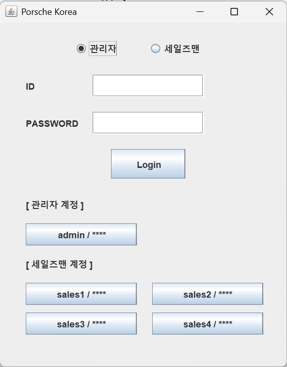
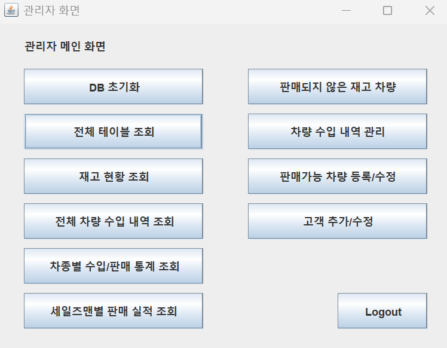
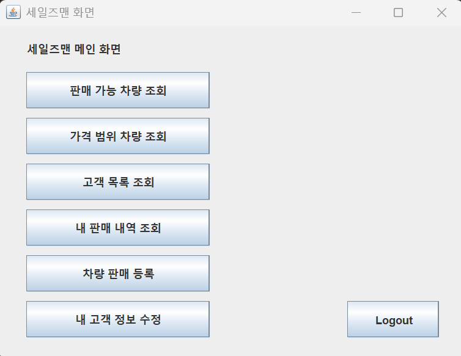
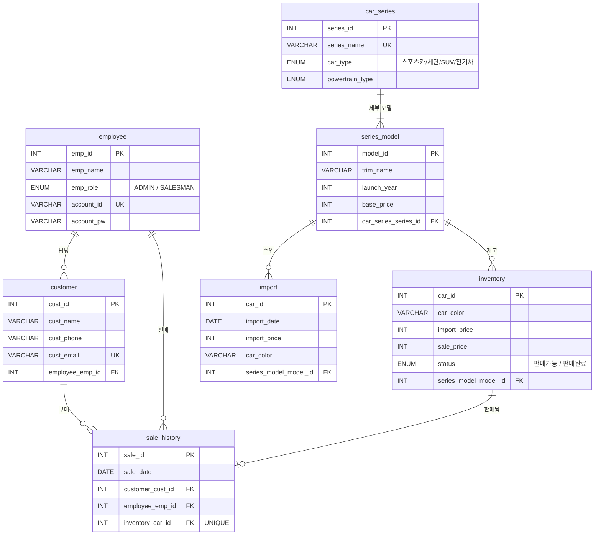

# Porsche Korea 수입차 판매 관리 시스템

MySQL과 Java Swing으로 만든 수입차 판매회사(포르쉐코리아) 관리 프로그램입니다.
차량 **수입 → 재고 등록 → 판매**의 흐름을 관계형 데이터베이스로 모델링했고,
관리자와 세일즈맨이 **서로 다른 MySQL 계정과 권한**으로 접속하도록 설계했습니다.

> 2026년 1학기 데이터베이스 수업 프로젝트(1인)로 제작했으며, 제출 후 실행 오류 수정과 코드 정리를 진행했습니다.
> → [과제 제출 후 개선한 점](#과제-제출-후-개선한-점)

## 기술 스택

| 구분 | 사용 기술 |
|---|---|
| Language | Java (JDK 24+, 개발 환경 JDK 26) |
| GUI | Java Swing (JDK 기본 라이브러리만 사용) |
| Database | MySQL 8.0.15+ |
| DB 연동 | JDBC (MySQL Connector/J 9.x) |
| 설계 도구 | MySQL Workbench (EER Diagram) |
| IDE | Eclipse |

## 실행 화면

| 로그인 | 관리자 메인 | 세일즈맨 메인 |
|---|---|---|
|  |  |  |

## 주요 기능

**관리자 (admin)**
- DB 초기화: 모든 테이블을 삭제하고 다시 만든 뒤 샘플 데이터 입력
- 전체 테이블 조회
- 차량 재고 현황, 판매 가능 차량 조회
- 차량 수입 내역 조회, 추가/수정
- 차종별 수입 금액 및 판매 통계
- 세일즈맨별 판매 실적
- 미판매 재고 수량 및 내역
- 수입 차량을 판매용 재고로 등록/수정
- 고객 추가/수정

**세일즈맨 (sales1 ~ sales4)**
- 판매 가능 차량 조회, 가격 범위별 조회
- 고객 목록 조회
- 본인 판매 내역 조회
- 본인 고객에 대한 판매 등록 (차량 상태 자동 변경)
- 본인 담당 고객 정보 수정

## 데이터베이스 설계

### ERD



### 설계 포인트
- **차종과 세부 모델 분리:** 차종 8종(`car_series`)과 트림별 모델 16개(`series_model`)를 나눠 1:N으로 정규화했습니다. 차종, 파워트레인 같은 정보가 모델마다 반복 저장되지 않습니다.
- **수입과 재고 분리:** 수입 기록(`import`)과 실제 판매용 재고(`inventory`)를 별도 테이블로 두었습니다. 수입된 차량을 관리자가 판매가를 정해 재고로 등록하는 업무 흐름을 그대로 반영했습니다.
- **중복 판매 방지:** `sale_history.inventory_car_id`에 `UNIQUE` 제약을 걸어, 같은 차량이 두 번 판매 등록되는 것을 DB 수준에서 막았습니다.
- **값 제한:** 직급, 차종, 판매 상태는 `ENUM`으로 정의해 허용되지 않은 값이 들어오지 않게 했습니다.

### 계정별 권한 분리 (GRANT)

애플리케이션 로그인과 별개로, **MySQL 계정 자체를 역할별로 나눴습니다.**
세일즈맨 화면은 권한이 제한된 `user1` 계정으로만 DB에 접속합니다.

| MySQL 계정 | 사용 화면 | 권한 |
|---|---|---|
| `root` | 관리자 | DBTEST 전체 권한 |
| `user1` | 세일즈맨 | 전체 테이블 `SELECT`<br>`customer`, `sale_history` `INSERT`<br>`customer`, `inventory` `UPDATE` |

```sql
GRANT SELECT ON DBTEST.inventory     TO 'user1'@'localhost';
GRANT INSERT ON DBTEST.sale_history  TO 'user1'@'localhost';
GRANT UPDATE ON DBTEST.inventory     TO 'user1'@'localhost';
-- DELETE, DROP, import 테이블 수정 등은 부여하지 않음
```

애플리케이션 코드에 버그가 있더라도 세일즈맨 계정으로는 판매 기록 삭제나 수입 내역 변경이 **DB에서 거부**됩니다.
본인 고객/판매 건만 수정할 수 있는 제한은 애플리케이션에서 `WHERE employee_emp_id = ?` 조건으로 처리했습니다.

## 주요 SQL

**차종별 수입·판매 통계** (`ImportSalesStatisticsFrame`)
`LEFT JOIN`으로 아직 수입되지 않았거나 판매되지 않은 차종도 0으로 표시하고, `CASE`로 판매 완료 건만 골라 집계합니다.

```sql
SELECT cs.series_name                    AS 모델명,
       COUNT(DISTINCT i.car_id)          AS 수입대수,
       IFNULL(SUM(i.import_price), 0)    AS 총수입금액,
       SUM(CASE WHEN inv.status = '판매완료' THEN 1 ELSE 0 END)                AS 판매대수,
       IFNULL(SUM(CASE WHEN inv.status = '판매완료' THEN inv.sale_price ELSE 0 END), 0) AS 총판매금액
FROM car_series cs
JOIN series_model sm   ON cs.series_id = sm.car_series_series_id
LEFT JOIN `import` i   ON sm.model_id = i.series_model_model_id
LEFT JOIN inventory inv ON i.car_id = inv.car_id
GROUP BY cs.series_id, cs.series_name
ORDER BY cs.series_id;
```

**세일즈맨별 판매 실적** (`SalesmanPerformanceFrame`)
판매 실적이 없는 세일즈맨도 결과에서 빠지지 않도록 `employee`를 기준으로 `LEFT JOIN` 했습니다.

```sql
SELECT e.emp_id, e.emp_name,
       COUNT(sh.sale_id)                    AS 판매대수,
       IFNULL(SUM(inv.sale_price), 0)       AS 총판매금액,
       IFNULL(ROUND(AVG(inv.sale_price)), 0) AS 평균판매금액
FROM employee e
LEFT JOIN sale_history sh ON e.emp_id = sh.employee_emp_id
LEFT JOIN inventory inv   ON sh.inventory_car_id = inv.car_id
WHERE e.emp_role = 'SALESMAN'
GROUP BY e.emp_id, e.emp_name;
```

사용자 입력이 들어가는 쿼리는 모두 `PreparedStatement`로 처리해 SQL Injection을 막았습니다.
판매 등록은 여러 쿼리를 하나의 트랜잭션으로 묶어 처리합니다 ([개선 4](#4-판매-등록을-하나의-트랜잭션으로-처리)).

## 과제 제출 후 개선한 점

### 1. 새 컴퓨터에서 프로그램이 아예 실행되지 않던 문제

**증상**
개발한 PC에서는 잘 돌아갔지만, 다른 PC에서 실행하면 로그인부터 `DB 오류 발생`이 뜨고 아무 기능도 쓸 수 없었습니다.

**원인**
초기화 순서에 순환 의존이 있었습니다.
1. 로그인 화면이 `jdbc:mysql://localhost:3306/DBTEST`로 접속해 `employee` 테이블을 조회함 → 새 PC에는 DBTEST가 없어 실패
2. DB를 만들어주는 "DB 초기화" 기능은 **관리자로 로그인해야** 누를 수 있음
3. 그 초기화 코드조차 아직 없는 `DBTEST`를 URL에 지정해 접속하고 있었음
4. 세일즈맨이 쓰는 `user1` 계정도 초기화 스크립트가 만들어 주기 때문에 역시 존재하지 않음

결국 개발 PC처럼 **DB가 이미 만들어진 환경에서만** 동작하는 구조였습니다.

**해결**
- `DbInitializer` 클래스를 만들어, 데이터베이스를 지정하지 않은 서버 URL(`localhost:3306/`)에 root로 접속하도록 했습니다.
- `information_schema.tables`에서 `DBTEST.employee` 테이블이 있는지 확인하고, 없으면 `db_init.sql`을 자동 실행합니다.
- 이 확인을 `Main`에서 **로그인 화면을 띄우기 전에** 수행하도록 순서를 바꿨습니다.
- 관리자 "DB 초기화" 버튼도 같은 코드를 쓰도록 통일했습니다.
- MySQL이 꺼져 있거나 비밀번호가 다를 때는 원인을 안내하는 메시지를 띄웁니다.

빈 MySQL 서버에서 첫 실행 시 자동 생성되는지, 두 번째 실행 시 다시 만들지 않는지, `user1`의 `DELETE`가 거부되는지 확인했습니다.

### 2. 흩어진 DB 접속 코드 통합
화면 클래스 16개에 `DriverManager.getConnection("jdbc:mysql://...", "root", "1234")`가 **33번** 복사되어 있었습니다.
접속 정보를 바꾸려면 모든 파일을 고쳐야 했기 때문에 `util.DBConnection`으로 모았습니다.

```java
// 변경 전 (각 화면마다 반복)
Class.forName("com.mysql.cj.jdbc.Driver");
Connection conn = DriverManager.getConnection(
        "jdbc:mysql://localhost:3306/DBTEST", "root", "1234");

// 변경 후
Connection conn = DBConnection.admin();     // 관리자 (root)
Connection conn = DBConnection.salesman();  // 세일즈맨 (user1)
```

### 3. 다른 PC에서 빌드되도록 프로젝트 설정 수정
`.classpath`에 `C:/Program Files/Java/jdk-26.0.1/...` 같은 개발 PC 전용 절대 경로가 들어 있어 Eclipse에서 바로 열 수 없었습니다.
JDBC 드라이버는 프로젝트 내부 `lib/` 폴더의 상대 경로로, JDK는 Eclipse 기본 JDK를 쓰도록 바꿨습니다.

### 4. 판매 등록을 하나의 트랜잭션으로 처리

**문제**
판매 등록은 `sale_history`에 판매 내역을 넣고(`INSERT`), `inventory`의 차량 상태를 `판매완료`로 바꾸는(`UPDATE`) 두 단계입니다.
기존 코드는 두 쿼리가 각각 자동 커밋되어, 중간에 오류가 나면 **판매 기록은 있는데 차량은 계속 `판매가능`** 인 상태가 남을 수 있었습니다.
또 검증 단계에서 `return`할 때 DB 연결을 닫지 않아 연결이 새는 문제도 있었습니다.

**해결** (`SalesRegisterFrame.registerSale`)
- `setAutoCommit(false)`로 고객 확인, 차량 확인, INSERT, UPDATE를 한 트랜잭션으로 묶고, 하나라도 실패하면 `rollback` 합니다.
- 차량 확인을 `SELECT ... FOR UPDATE`로 바꿔 해당 행을 잠급니다. 두 세일즈맨이 같은 차량을 동시에 등록해도 한 명만 성공합니다.
- `UPDATE ... WHERE status='판매가능'`의 영향받은 행 수가 1이 아니면 실패로 처리합니다.
- `try-with-resources`로 연결과 Statement가 항상 닫히게 했습니다.

```java
try (Connection conn = DBConnection.salesman()) {
    conn.setAutoCommit(false);
    try {
        String error = registerSale(conn, custId, carId, saleDate); // 확인 → INSERT → UPDATE
        if (error != null) { conn.rollback(); /* 안내 메시지 */ return; }
        conn.commit();
    } catch (Exception e) {
        conn.rollback();
        throw e;
    }
}
```

**검증**
| 상황 | 결과 |
|---|---|
| 정상 판매 | 커밋, 판매 내역 1건 + 상태 `판매완료` |
| 이미 판매된 차량 | 거부, 변경 없음 |
| 다른 세일즈맨의 고객 | 거부, 변경 없음 |
| INSERT 후 UPDATE 실패 (권한을 일부러 빼서 재현) | **롤백**, 판매 내역 0건으로 원상 복구 |

### 앞으로 개선할 점
- **DAO 계층 분리:** 지금은 Swing 화면 클래스 안에 SQL이 들어 있습니다. 데이터 접근 코드를 DAO로 분리하면 화면과 DB 로직을 따로 테스트하고 수정할 수 있습니다.
- **비밀번호 보안:** 접속 비밀번호는 설정 파일로, 계정 비밀번호는 해시로 저장하는 방식으로 바꿀 수 있습니다.

## 설치 및 실행

### 1. MySQL 준비
MySQL 서버를 `localhost:3306`에서 실행하고, **root 비밀번호를 `1234`** 로 설정합니다.

```sql
ALTER USER 'root'@'localhost' IDENTIFIED BY '1234';
```

> DBTEST 데이터베이스와 `user1` 계정은 직접 만들 필요가 없습니다.
> 프로그램을 처음 실행하면 `db_init.sql`이 자동으로 실행되어 스키마, 계정, 샘플 데이터가 생성됩니다.

### 2. JDBC 드라이버 추가
[MySQL Connector/J](https://dev.mysql.com/downloads/connector/j/)를 내려받아
`lib/mysql-connector-j-9.7.0.jar` 이름으로 넣습니다.
(다른 버전을 쓰면 Eclipse에서 Build Path를 해당 파일로 바꿔주세요.)

### 3. 실행

**Eclipse**
1. `File > Import > Existing Projects into Workspace`로 이 폴더를 불러옵니다.
2. `src/Main.java`를 실행합니다.

**명령줄** (프로젝트 루트에서 실행해야 `db_init.sql`을 찾을 수 있습니다)
```bash
# Windows는 ':' 대신 ';'
javac -encoding UTF-8 -d bin -cp lib/mysql-connector-j-9.7.0.jar $(find src -name "*.java")
java -cp bin:lib/mysql-connector-j-9.7.0.jar Main
```

### 샘플 계정

| 구분 | ID | PW |
|---|---|---|
| 관리자 | admin | 1234 |
| 세일즈맨 | sales1 ~ sales4 | 1234 |

로그인 화면의 계정 버튼을 누르면 바로 로그인됩니다.

## 프로젝트 구조

```
├── db_init.sql                  # 스키마 + user1 계정/권한 + 샘플 데이터
├── lib/                         # MySQL Connector/J jar 위치
├── docs/screenshots/            # README용 실행 화면
└── src/
    ├── Main.java                # 시작점: DB 확인/자동 생성 → 로그인 화면
    ├── util/
    │   ├── DBConnection.java    # DB 접속 정보 관리 (admin / salesman / server)
    │   ├── DbInitializer.java   # DB 존재 확인 및 초기화 스크립트 실행
    │   └── DbTableUtil.java     # ResultSet → JTable 모델 변환
    └── ui/                      # Swing 화면 18개 (로그인, 관리자/세일즈맨 메인, 각 기능 화면)
```

## 참고
학습용 프로젝트라서 DB 비밀번호가 코드에 들어 있고, 계정 비밀번호도 평문으로 저장됩니다. 실제 서비스에는 사용하지 마세요.
